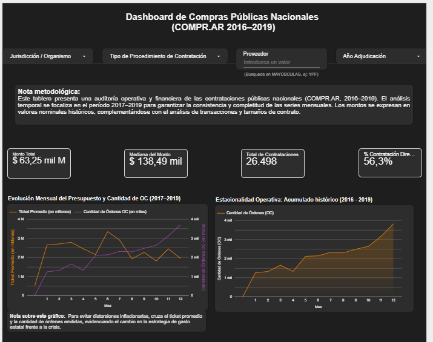

# 📊 Auditoría de Compras Públicas Nacionales (COMPR.AR 2017–2019)

Análisis exploratorio de datos (EDA), proceso de limpieza (ETL) y tablero interactivo de Business Intelligence desarrollado sobre el portal de Datos Abiertos del Estado Nacional Argentino (**COMPR.AR**).

> 🔗 **[Ver Dashboard Interactivo en Looker Studio](https://datastudio.google.com/reporting/25dfb836-00d0-4ab3-acdf-41d920880d55)**

---

## 🎯 Objetivo del Proyecto
Transformar microdatos administrativos dispersos en una herramienta de auditoría operativa y financiera para radiografiar cómo el Estado Nacional distribuyó su presupuesto entre **2017 y 2019**, identificando modalidades de contratación predominantes, comportamiento estacional del gasto y perfil de proveedores y organismos ejecutores.

---

## 🛠️ Stack Tecnológico
* **Lenguaje y Procesamiento:** Python (Pandas, NumPy) en Google Colab.
* **Visualización y BI:** Google Looker Studio.
* **Control de Calidad:** Validación cruzada entre DataFrames procesados y agregaciones visuales.

---

## 📈 Métricas Clave y Hallazgos Principales

Sobre un volumen auditado de **26.498 Órdenes de Compra (OC)** y un presupuesto total adjudicado de **$ 63,25 mil millones ARS** (valores nominales históricos):

1. **Mecánica Dual de Contratación (Volumen vs. Masa Financiera):**
   * La **Contratación Directa** concentra el **56,3%** de las transacciones (compras atomizadas para la operatoria cotidiana).
   * La **Licitación Pública** representa una minoría en cantidad de operaciones, pero absorbe casi el **47% del presupuesto total** debido a obras y adquisiciones de gran envergadura.
2. **Impacto de *Outliers* y Uso de la Mediana:**
   * Debido a la fuerte asimetría provocada por contratos multimillonarios que distorsionan la media aritmética, la **Mediana ($ 138.490 ARS)** se consolidó como el indicador robusto para representar el costo típico de una contratación estatal.
3. **Estacionalidad Operativa ("Efecto Fin de Año"):**
   * El cruce temporal entre *Ticket Promedio* y *Cantidad de Órdenes de Compra* evidencia una concentración sistemática de ejecuciones en **noviembre y diciembre**, vinculada al cierre del ejercicio fiscal y la necesidad administrativa de devengar partidas asignadas.
4. **Reconfiguración Ministerial:**
   * Mientras que al inicio del período predominaron carteras de infraestructura y obra pública, hacia 2019 el gasto se reorientó hacia áreas operativas esenciales, salud y defensa (liderando el ranking acumulado el Ministerio de Salud y Desarrollo Social y la Secretaría de Gobierno de Salud).

---

## ⚠️ Decisiones Metodológicas y Limitaciones
* **Recorte Temporal (2017–2019):** Si bien el dataset original abarca 2016–2019, las series temporales mensuales se focalizaron en el trienio completo 2017–2019, excluyendo años extremos con carga incompleta que sesgaban las métricas anuales.
* **Valores Nominales Históricos:** Los montos no fueron deflactados por IPC; para aislar la distorsión inflacionaria en el análisis visual, se evaluó la evolución del volumen de órdenes emitidas junto al ticket promedio.

---

## 📂 Estructura del Repositorio
* `notebooks/`: Scripts en Python con el proceso de limpieza (normalización de CUIT, depuración de nulos/ceros y tipado de fechas) y análisis estadístico.
* `dashboard/`: Exportación en PDF y captura visual del tablero en Looker Studio.
* `docs/`: Informe ejecutivo final con metodología, hallazgos y documentación de validaciones.

---
**Autora:** Sandra L. Domínguez — *Tecnicatura Superior en Ciencia de Datos e Inteligencia Artificial (ISFT 204)*
